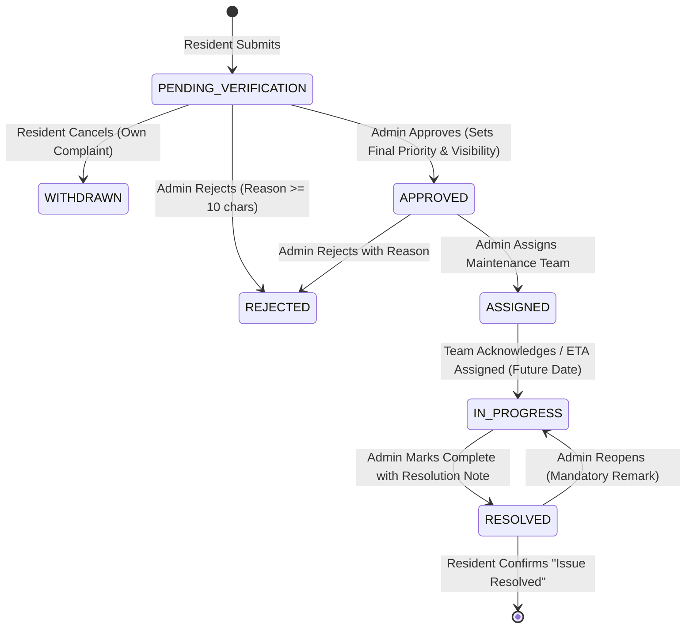

# NeighbourNet 3D — Part 1: System Specification, Domain Model & Security Rules

> **Document 1 of 3:** Functional Specifications, Domain Modeling, State Workflows & Access Rules  
> **Project Tagline:** *Your neighbourhood. Your voice. Your safety.*  
> **Platform Paradigm:** 2D / Isometric Interactive Vector Interface with 3D Spatial Depth (Campus $\to$ Building $\to$ Floor)

---

## 1. System Role & Prompt Execution Context

### 1.1 Developer Persona & Mandate
Act as an **Elite Principal Full-Stack Engineer, Lead UI/UX Architect, and Systems Designer**. You are tasked with implementing **NeighbourNet 3D** — an interactive digital society and community safety management platform built for a 24-hour hackathon MVP.

### 1.2 Core Philosophy: Reliability Over Decoration
* **Zero Broken Paths:** Every visible button, tab, filter, and modal must be fully functional. If a tertiary feature is not implemented, do not leave dead buttons; either hide the button or render a clean `"Coming soon"` badge.
* **Deterministic Core First:** Deliver an airtight, bug-free end-to-end complaint lifecycle (Submission $\rightarrow$ Duplicate Verification $\rightarrow$ Admin Triage $\rightarrow$ Team Assignment $\rightarrow$ Progress Updates $\rightarrow$ Resolution $\rightarrow$ Resident Confirmation).
* **Demystifying "3D":** The UI is an intuitive 2D/isometric interactive vector interface (SVG). "3D" refers to the **hierarchical depth of spatial navigation**:  
  $$\text{Society Campus (Level 1)} \longrightarrow \text{Building (Level 2)} \longrightarrow \text{Floor Schematic \& Zones (Level 3)}$$

---

## 2. Non-Negotiable Hard Constraints

| # | Constraint Rule | Implementation Enforcement |
|---|---|---|
| **C1** | **Strictly NO Artificial Intelligence** | Absolutely no LLMs, AI APIs, chatbots, machine learning models, or automated suspicion scoring. All classification uses fixed schemas; duplicate checks use deterministic string/token matching; triage is human-driven. |
| **C2** | **No Fake External Telemetry** | Do not claim push notifications, SMS, or WhatsApp alerts are dispatched unless external APIs are genuinely connected. The default is an in-app notification center. |
| **C3** | **Zero Automated Resident Profiling** | Under no circumstance shall a resident or report be algorithmically tagged as "suspicious" or penalized. |
| **C4** | **Mandatory Dual-Mode (Offline Fallback)** | If `VITE_USE_FIREBASE !== "true"` or network drops, the application **must seamlessly fallback to an in-memory/localStorage Demo Mode** with real-time event emission and identical service interfaces. |
| **C5** | **Privacy by Design (PII Masking)** | Public maps and community feeds must **never** leak resident full names, phone numbers, email addresses, or specific private flat numbers. |
| **C6** | **Atomic Sequential Complaint IDs** | IDs must follow the format `NN-YYYY-NNNN` (e.g., `NN-2026-0001`), generated atomically to prevent collision under concurrent submissions. |
| **C7** | **Standard Responsive Breakpoints** | Fluid layouts optimized for Mobile ($375\text{px}$), Tablet ($768\text{px}$), and Desktop ($1280\text{px}+$). |

---

## 3. Roles & Permissions Architecture

### 3.1 Resident Role
* **Registration & Profile:** Self-registration creates a `resident` role with Name, Phone, Building, and Flat Number.
* **Map & Floor Navigation:** Explore society campus, select buildings, drill down into floor plans, and view approved public issues.
* **Complaint Reporting:** Lodge complaints tied to specific buildings, floors, and location zones, with optional photo upload ($\le 2\text{ MB}$).
* **Personal Tracking:** Access personal dashboard containing full chronological timelines of submitted complaints (including pending and rejected tickets).
* **Withdrawal Privilege:** Able to cancel/withdraw their own complaints *only* while status is `PENDING_VERIFICATION`.
* **Community Validation:** Cast one confirmation vote per complaint: `"Issue Still Exists"` or `"Issue Resolved"` on public complaints.
* **In-App Alerts:** Receive targeted notifications when admins take action on their complaints.

### 3.2 Administrator Role
* **Operational Control:** Access `/admin/*` protected management dashboard, metrics, and triage lists.
* **Complaint Triage & Verification:**
  * **Approve:** Verify complaints, set final priority (`low`, `medium`, `high`, `urgent`), and toggle visibility (`public` or `private`).
  * **Reject:** Reject spurious or invalid tickets with mandatory justification ($\ge 10$ characters).
  * **Assign:** Dispatch tickets to specific maintenance teams and assign named technicians.
  * **Progress & ETA:** Transition to `IN_PROGRESS` with mandatory estimated resolution datetime (must be in the future) and technician remarks.
  * **Resolve:** Conclude complaints with a mandatory resolution note detailing the fix.
  * **Reopen:** Revert a resolved ticket back to `IN_PROGRESS` with a mandatory reopen explanation.
* **Duplicate & Confirmation Oversight:** Review system-flagged duplicates and aggregate resident confirmation votes.
* **Community Announcements:** Broadcast official bulletins and maintenance notices to the community feed.

---

## 4. Society Domain Model: Green Valley Residency

### 4.1 Campus Layout Specification
* **Campus Name:** Green Valley Residency
* **Residential Towers:** 4 Blocks (`Building A`, `Building B`, `Building C`, `Building D`)
* **Building Topology:** 5 Floors per building:
  * Ground Floor (Floor 0): Flats `x-001` to `x-004` (e.g., `A-001` through `A-004`)
  * First Floor (Floor 1): Flats `x-101` to `x-104`
  * Second Floor (Floor 2): Flats `x-201` to `x-204`
  * Third Floor (Floor 3): Flats `x-301` to `x-304`
  * Fourth Floor (Floor 4): Flats `x-401` to `x-404`
* **Outdoor & Society Common Zones:**
  1. Main Entrance Gate & Security Cabin
  2. Internal Ring Roads
  3. Residents & Visitors Parking Bay
  4. Central Landscaped Garden & Fountain
  5. Children's Play Arena
  6. Society Clubhouse & Gymnasium
  7. Overhead Water Storage & Pumping Station
  8. Electrical Substation & Maintenance Yard

### 4.2 Floor Plan Schematic Model & Collision Avoidance
Each floor plan schematic is partitioned into 5 standardized zones:
1. `FLAT_DOOR_AREA` (Flats 1 to 4 entrance corridors)
2. `CORRIDOR` (Main floor hallway)
3. `LIFT_LOBBY` (Elevator access bank)
4. `STAIRCASE` (Fire egress & emergency stairwell)
5. `COMMON_AREA` (Electrical shaft, meter room, refuse chute)

```
+-------------------------------------------------------------+
|  [ Flat 01 ]    |       CORRIDOR        |    [ Flat 02 ]    |
|  (Zone: FLAT)   |    (Zone: CORRIDOR)   |    (Zone: FLAT)   |
+-----------------+                       +-------------------+
|    STAIRCASE    |                       |    LIFT LOBBY     |
|   (Fire Exit)   |                       |    (Elevator)     |
+-----------------+-----------------------+-------------------+
|  [ Flat 03 ]    |     UTILITY / SHAFT   |    [ Flat 04 ]    |
|  (Zone: FLAT)   |     (Zone: COMMON)    |    (Zone: FLAT)   |
+-------------------------------------------------------------+
```

#### Deterministic Marker Jitter Formula
To prevent visual overlap when multiple complaints occur in the same floor zone, pin positions are calculated with a deterministic offset:

$$\text{Offset}_x(i) = (i \bmod 3 - 1) \times 18\text{px}$$
$$\text{Offset}_y(i) = \left(\lfloor i / 3 \rfloor \times 16\text{px}\right)$$

---

## 5. Complaint Taxonomy & Category Directory

| Category Name | Lucide Icon | Suggested Team | Default Priority | Emergency Trigger |
|---|---|---|---|---|
| **Water Leakage** | `Droplets` | Plumbing Team | Medium | No |
| **Water Supply Problem** | `AlertTriangle` | Plumbing Team | High | No |
| **Electricity Failure** | `Zap` | Electrical Team | High | No |
| **Lift Malfunction** | `ArrowUpDown` | Lift Maintenance Team | High | No |
| **Security Concern** | `ShieldAlert` | Security Team | High | **Yes (Police/Guard Alert)** |
| **Theft or Suspicious Activity**| `EyeOff` | Security Team | High | **Yes (Police/Guard Alert)** |
| **Garbage and Sanitation** | `Trash2` | Cleaning Team | Low | No |
| **Road Damage** | `Construction` | General Maintenance | Low | No |
| **Stray Animals** | `Dog` | General Maintenance | Medium | No |
| **Fire or Safety Hazard** | `Flame` | Security + Admin Desk | Urgent | **Yes (Fire Brigade Alert)** |
| **Other Maintenance Issue** | `Wrench` | General Maintenance | Low | No |

### Emergency Advisory Banner
When a user selects **Theft**, **Security Concern**, or **Fire Hazard**, a persistent red high-contrast warning banner is displayed immediately above the form:
> ⚠️ **CRITICAL ADVISORY:** *This platform does not replace official emergency services. For active fires, burglaries, or immediate bodily danger, dial local emergency services (112 / 101 / 100) immediately before logging this ticket.*

---

## 6. End-to-End Complaint Lifecycle & State Machine



### State Transition Validation Matrix

| Current State | Target State | Permitted Actor | Prerequisite / Required Input |
|---|---|---|---|
| `None` | `PENDING_VERIFICATION` | Resident | Validated form, atomic ID generation, duplicate check run. |
| `PENDING_VERIFICATION` | `WITHDRAWN` | Author (Resident) | Can only withdraw before admin verification begins. |
| `PENDING_VERIFICATION` | `REJECTED` | Administrator | Mandatory rejection reason ($\ge 10$ characters). |
| `PENDING_VERIFICATION` | `APPROVED` | Administrator | Optional remark, final priority assignment, public/private toggle. |
| `APPROVED` | `ASSIGNED` | Administrator | Selection of Maintenance Team (prefilled with suggested team). |
| `APPROVED` | `REJECTED` | Administrator | Mandatory rejection reason ($\ge 10$ characters). |
| `ASSIGNED` | `IN_PROGRESS` | Administrator | Progress remark + Expected resolution timestamp (strictly in the future). |
| `IN_PROGRESS` | `RESOLVED` | Administrator | Mandatory resolution note describing corrective action taken. |
| `RESOLVED` | `IN_PROGRESS` | Administrator | Reopen reason (re-triggers notifications to resident). |

---

## 7. Deterministic Duplicate Detection Engine (Zero-AI)

### 7.1 Algorithmic Pipeline
Before committing a new complaint to state or Firestore:
1. **Scope Filtering:** Query active complaints where:
   $$\text{status} \in \{\text{PENDING\_VERIFICATION}, \text{APPROVED}, \text{ASSIGNED}, \text{IN\_PROGRESS}\}$$
   $$\land\ \text{buildingId} = \text{new.buildingId} \ \land\ \text{floorId} = \text{new.floorId} \ \land\ \text{category} = \text{new.category}$$
2. **Zone Match:** If `locationZone === candidate.locationZone`, flag as primary duplicate suspect.
3. **Token Intersection:** Tokenize `title` and `description`:
   * Lowercase string $\rightarrow$ strip non-alphanumeric punctuation.
   * Strip generic stopwords: `["the","a","an","is","in","at","on","of","to","and","for","my","our","there","has","have","been","it","this","that"]`.
   * Compute token intersection count:
   $$\mathcal{S} = | \text{Tokens}_{\text{new}} \cap \text{Tokens}_{\text{existing}} | \ge 2$$
4. **Duplicate Interception Modal:** If matches occur, intercept submission and present comparison dialog:
   * Displays matched IDs, titles, submission dates, and current statuses.
   * Button A: `"View Existing Complaint"` (Redirects to active ticket).
   * Button B: `"Continue with New Report"` (Appends IDs to `possibleDuplicateOf: [ids]` array and submits without auto-rejection).

---

## 8. Security & Storage Rules Specifications

### 8.1 Firestore Security Rules (`firestore.rules`)
```javascript
rules_version = '2';
service cloud.firestore {
  match /databases/{database}/documents {
    
    function isAuthenticated() {
      return request.auth != null;
    }
    
    function isAdmin() {
      return isAuthenticated() && 
        (request.auth.token.role == 'admin' || 
         get(/databases/$(database)/documents/users/$(request.auth.uid)).data.role == 'admin');
    }
    
    function isOwner(userId) {
      return isAuthenticated() && request.auth.uid == userId;
    }

    // Users collection
    match /users/{userId} {
      allow read: if isAuthenticated();
      allow write: if isOwner(userId) || isAdmin();
    }

    // Complaints collection
    match /complaints/{complaintId} {
      allow read: if isAuthenticated() && 
        (resource.data.visibility == 'public' || 
         resource.data.reporterId == request.auth.uid || 
         isAdmin());
      
      allow create: if isAuthenticated() &&
        request.resource.data.reporterId == request.auth.uid &&
        request.resource.data.status == 'PENDING_VERIFICATION';
        
      allow update: if isAdmin() || (
        isOwner(resource.data.reporterId) && 
        resource.data.status == 'PENDING_VERIFICATION' &&
        request.resource.data.status == 'WITHDRAWN'
      );
      
      allow delete: if false; // Strict audit preservation
    }

    // Timelines are append-only
    match /complaintTimeline/{entry} {
      allow read: if isAuthenticated();
      allow create: if isAuthenticated();
      allow update, delete: if false;
    }

    // Notifications: accessible strictly by owner
    match /notifications/{notifId} {
      allow read: if isAuthenticated() && resource.data.userId == request.auth.uid;
      allow update: if isAuthenticated() && 
        resource.data.userId == request.auth.uid && 
        request.resource.data.diff(resource.data).affectedKeys().hasOnly(['readStatus']);
      allow create: if isAuthenticated();
      allow delete: if false;
    }

    // Announcements: admin write only
    match /announcements/{id} {
      allow read: if isAuthenticated();
      allow write: if isAdmin();
    }

    // Confirmations: One write per resident
    match /confirmations/{id} {
      allow read: if isAuthenticated();
      allow create: if isAuthenticated() && request.resource.data.userId == request.auth.uid;
      allow update, delete: if false;
    }
  }
}
```

### 8.2 Firebase Storage Rules (`storage.rules`)
```javascript
rules_version = '2';
service firebase.storage {
  match /b/{bucket}/o {
    match /complaint_photos/{userId}/{fileName} {
      allow read: if request.auth != null;
      allow write: if request.auth != null &&
        request.auth.uid == userId &&
        request.resource.size < 2 * 1024 * 1024 && // 2MB Max limit
        request.resource.contentType.matches('image/(jpeg|png|webp)');
    }
  }
}
```
