# NeighbourNet 3D — Part 3: Seed Fixtures, 24-Hour Build Plan & Demo Script

> **Document 3 of 3:** Demo Data Fixtures, Time-Boxed Schedule, 15-Step Presentation & QA Matrix  
> **Project Tagline:** *Your neighbourhood. Your voice. Your safety.*  
> **Target Audience:** Hackathon Judges, Evaluators, Engineering Team

---

## 1. Demo Personas & Pre-Configured Test Credentials

To ensure instant, frictionless testing during hackathon evaluations, two pre-configured accounts are provided with one-click access in the login portal:

| Persona | Email | Password | Role | Assigned Flat & Location |
|---|---|---|---|---|
| **Resident** | `resident@demo.com` | `Demo@1234` | `resident` | Building A, Flat 203 (Phone: +91 98201 22334) |
| **Administrator** | `admin@demo.com` | `Admin@1234` | `admin` | Facility Office, Clubhouse (Phone: +91 98111 99887) |

---

## 2. Deterministic Mock Seed Data Fixtures

All records are pre-labeled with `"Sample / Demo record"` to distinguish them from newly logged complaints.

### 2.1 Baseline 8 Complaint Fixtures
```json
[
  {
    "complaintId": "NN-2026-0001",
    "title": "Severe overhead pipeline leakage near lift shaft",
    "category": "Water Leakage",
    "description": "Continuous water drip from the secondary ceiling pipe right outside Flat 202 and the lift entrance. Water is pooling rapidly.",
    "buildingId": "bldg-a",
    "floorId": "bldg-a-f2",
    "exactLocation": "Opposite Elevator Door, 2nd Floor",
    "locationZone": "LIFT_LOBBY",
    "reporterId": "mock-resident-uid",
    "suggestedPriority": "high",
    "priority": "high",
    "status": "IN_PROGRESS",
    "visibility": "public",
    "assignedTeamId": "team-plumbing",
    "assignedTo": "Ramesh (Master Plumber)",
    "expectedResolutionAt": "2026-10-31T18:00:00Z",
    "createdAt": "2026-10-30T09:15:00Z",
    "updatedAt": "2026-10-30T11:00:00Z",
    "possibleDuplicateOf": [],
    "confirmationCounts": { "stillExists": 3, "resolved": 0 }
  },
  {
    "complaintId": "NN-2026-0002",
    "title": "Corridor tube light flickering and sparking",
    "category": "Electricity Failure",
    "description": "The main LED ballast in the hallway between flat 203 and 204 emits a buzzing sound and periodic sparks.",
    "buildingId": "bldg-a",
    "floorId": "bldg-a-f2",
    "exactLocation": "Mid-Corridor Ceiling Junction",
    "locationZone": "CORRIDOR",
    "reporterId": "mock-resident-uid",
    "suggestedPriority": "medium",
    "priority": "high",
    "status": "APPROVED",
    "visibility": "public",
    "assignedTeamId": "team-electrical",
    "createdAt": "2026-10-30T10:30:00Z",
    "updatedAt": "2026-10-30T11:15:00Z",
    "possibleDuplicateOf": [],
    "confirmationCounts": { "stillExists": 1, "resolved": 0 }
  },
  {
    "complaintId": "NN-2026-0003",
    "title": "Tower B Elevator jerking and halting between floors",
    "category": "Lift Malfunction",
    "description": "Passenger elevator stops abruptly between 3rd and 4th floors with loud grinding mechanical noises.",
    "buildingId": "bldg-b",
    "floorId": "bldg-b-f3",
    "exactLocation": "Passenger Lift No. 1",
    "locationZone": "LIFT_LOBBY",
    "reporterId": "mock-user-2",
    "suggestedPriority": "high",
    "priority": "urgent",
    "status": "ASSIGNED",
    "visibility": "public",
    "assignedTeamId": "team-lift",
    "createdAt": "2026-10-30T08:00:00Z",
    "updatedAt": "2026-10-30T09:30:00Z",
    "possibleDuplicateOf": [],
    "confirmationCounts": { "stillExists": 5, "resolved": 0 }
  },
  {
    "complaintId": "NN-2026-0004",
    "title": "Refuse and garbage sacks piled in emergency staircase",
    "category": "Garbage and Sanitation",
    "description": "Cardboard boxes and decomposed wet waste dumped directly on fire egress stairs, blocking descent.",
    "buildingId": "bldg-c",
    "floorId": "bldg-c-f1",
    "exactLocation": "Stairwell Landing between 1st & Ground",
    "locationZone": "STAIRCASE",
    "reporterId": "mock-user-3",
    "suggestedPriority": "low",
    "priority": "medium",
    "status": "PENDING_VERIFICATION",
    "visibility": "public",
    "createdAt": "2026-10-30T12:00:00Z",
    "updatedAt": "2026-10-30T12:00:00Z",
    "possibleDuplicateOf": [],
    "confirmationCounts": { "stillExists": 0, "resolved": 0 }
  },
  {
    "complaintId": "NN-2026-0005",
    "title": "Suspicious trespasser inspecting door locks at night",
    "category": "Theft or Suspicious Activity",
    "description": "Unidentified individual in dark hoodie caught checking door handles on the 4th floor around 2:30 AM.",
    "buildingId": "bldg-d",
    "floorId": "bldg-d-f4",
    "exactLocation": "Outer Doorway Flats 401-402",
    "locationZone": "FLAT_DOOR_AREA",
    "reporterId": "mock-user-4",
    "suggestedPriority": "high",
    "priority": "urgent",
    "status": "PENDING_VERIFICATION",
    "visibility": "private",
    "createdAt": "2026-10-30T03:15:00Z",
    "updatedAt": "2026-10-30T03:15:00Z",
    "possibleDuplicateOf": [],
    "confirmationCounts": { "stillExists": 0, "resolved": 0 }
  },
  {
    "complaintId": "NN-2026-0006",
    "title": "Damaged asphalt pothole at vehicle exit curve",
    "category": "Road Damage",
    "description": "Deep tire rut exposing sharp gravel bed right before Gate 2 exit boom barrier.",
    "buildingId": "bldg-a",
    "floorId": "bldg-a-f0",
    "exactLocation": "Perimeter Road near Security Cabin",
    "locationZone": "COMMON_AREA",
    "reporterId": "mock-user-1",
    "suggestedPriority": "low",
    "priority": "low",
    "status": "RESOLVED",
    "visibility": "public",
    "assignedTeamId": "team-general",
    "resolutionNote": "Pothole filled with cold-mix asphalt and compacted.",
    "resolvedAt": "2026-10-29T16:00:00Z",
    "createdAt": "2026-10-28T10:00:00Z",
    "updatedAt": "2026-10-29T16:00:00Z",
    "possibleDuplicateOf": [],
    "confirmationCounts": { "stillExists": 0, "resolved": 4 }
  },
  {
    "complaintId": "NN-2026-0007",
    "title": "Aggressive stray dog pack near children's playground",
    "category": "Stray Animals",
    "description": "Three aggressive canines have taken shelter beneath the slide, barking at toddlers.",
    "buildingId": "bldg-b",
    "floorId": "bldg-b-f0",
    "exactLocation": "Central Garden Play Swing Area",
    "locationZone": "COMMON_AREA",
    "reporterId": "mock-user-5",
    "suggestedPriority": "high",
    "priority": "high",
    "status": "IN_PROGRESS",
    "visibility": "public",
    "assignedTeamId": "team-general",
    "assignedTo": "Municipal Animal Control Unit",
    "expectedResolutionAt": "2026-10-31T17:00:00Z",
    "createdAt": "2026-10-30T07:45:00Z",
    "updatedAt": "2026-10-30T08:30:00Z",
    "possibleDuplicateOf": [],
    "confirmationCounts": { "stillExists": 2, "resolved": 0 }
  },
  {
    "complaintId": "NN-2026-0008",
    "title": "Expired fire extinguisher pressure gauge in red zone",
    "category": "Fire or Safety Hazard",
    "description": "Dry powder extinguisher inspection cylinder shows zero bar pressure on Ground Floor lobby.",
    "buildingId": "bldg-c",
    "floorId": "bldg-c-f0",
    "exactLocation": "Main Lobby Fire Extinguisher Bracket",
    "locationZone": "COMMON_AREA",
    "reporterId": "mock-user-2",
    "suggestedPriority": "high",
    "priority": "urgent",
    "status": "REJECTED",
    "visibility": "public",
    "rejectionReason": "Duplicate of NN-2026-0000; replacement units ordered and being mounted today.",
    "createdAt": "2026-10-27T14:00:00Z",
    "updatedAt": "2026-10-27T15:00:00Z",
    "possibleDuplicateOf": ["NN-2026-0000"],
    "confirmationCounts": { "stillExists": 0, "resolved": 0 }
  }
]
```

### 2.2 Maintenance Teams & Categories
```json
[
  { "teamId": "team-plumbing", "name": "Plumbing & Water Works", "categoriesHandled": ["Water Leakage", "Water Supply Problem"] },
  { "teamId": "team-electrical", "name": "Electrical & Power Grid", "categoriesHandled": ["Electricity Failure"] },
  { "teamId": "team-lift", "name": "Otis Lift Maintenance AMC", "categoriesHandled": ["Lift Malfunction"] },
  { "teamId": "team-cleaning", "name": "Sanitation & Janitorial Staff", "categoriesHandled": ["Garbage and Sanitation"] },
  { "teamId": "team-security", "name": "Security & Vigilance Taskforce", "categoriesHandled": ["Security Concern", "Theft or Suspicious Activity", "Fire or Safety Hazard"] },
  { "teamId": "team-general", "name": "General Civil Works Team", "categoriesHandled": ["Road Damage", "Stray Animals", "Other Maintenance Issue"] }
]
```

### 2.3 Community Bulletins
```json
[
  {
    "announcementId": "ann-01",
    "title": "Mandatory DG Power Backup Testing",
    "message": "Diesel Generator sync testing scheduled for this Sunday from 2:00 PM to 4:00 PM. Expect brief 2-minute switchover flickers.",
    "createdBy": "Facility Management Committee",
    "createdAt": "2026-10-29T10:00:00Z"
  },
  {
    "announcementId": "ann-02",
    "title": "Overhead Tank Chlorination",
    "message": "Water supply to Towers A and B will be throttled between 1:00 PM and 3:30 PM on Thursday for biochemical cleaning.",
    "createdBy": "Health & Sanitation Desk",
    "createdAt": "2026-10-28T08:30:00Z"
  }
]
```

---

## 3. Step-by-Step 24-Hour Implementation Blueprint

```mermaid
gantt
    title 24-Hour Hackathon Implementation Schedule
    dateFormat  HH:mm
    axisFormat  %H:%M
    
    section Foundation
    Scaffolding, Router, Types & Dual Service Layer :00:00, 4h
    
    section Priority 1 Core
    SVG Campus Map & Floor Schematics               :04:00, 3h
    Complaint Form, Atomic IDs & Admin Transitions  :07:00, 3h
    
    section Priority 2 Features
    Rule-Based Duplicate Detection & Photos         :10:00, 3h
    Community Feed, Confirmations & Admin Charts    :13:00, 3h
    
    section Hardening & Polish
    Security Rules, Responsive Skeletons & Errors   :16:00, 4h
    
    section Demo Readiness
    E2E Rehearsal against Script & Demo Lock        :20:00, 4h
```



### Time-Boxed Milestones

* **Hours 00:00 – 04:00: System Foundation**
  - Project initialized with Vite, React, TypeScript, and Tailwind CSS.
  - Setup unified data contracts in `src/types/index.ts`.
  - Implement dual service layer (`complaintService`, `authService`, `eventEmitter`).
  - Configure Router with role-based route guards (`/dashboard`, `/admin/*`).
  - **Milestone:** Working login switcher, session persistence, and zero-config local storage data layer.

* **Hours 04:00 – 10:00: Priority 1 (Core Map & Complaint Pipeline)**
  - Build `CampusSvgMap.tsx` with building hover states, issue counts, and status indicators.
  - Build `FloorSchematic.tsx` with 5 zones and deterministic pin jitter offsets.
  - Create complaint submission page with automatic pre-fill of building and floor.
  - Implement atomic sequential ID generator (`NN-YYYY-NNNN`).
  - Implement admin actions (Approve, Reject, Assign, Progress, Resolve).
  - Build vertical timeline stepper showing full audit log.
  - **Milestone:** End-to-end complaint flow working smoothly from map to resolution.

* **Hours 10:00 – 16:00: Priority 2 (Duplicate Engine, Feed & Analytics)**
  - Integrate zero-AI duplicate detection algorithm and warning modal.
  - Support photo attachments with preview and removal option ($\le 2\text{ MB}$).
  - Build public Community Feed with `"Issue Still Exists"` and `"Issue Resolved"` resident confirmation buttons.
  - Implement in-app Notification Center with unread counter.
  - Build Admin Dashboard cards and Recharts analytics (Category & Building distributions).
  - **Milestone:** Complete resident engagement loop and administrative insights dashboard.

* **Hours 16:00 – 20:00: Hardening, Polish & Accessibility**
  - Verify `firestore.rules` and `storage.rules`.
  - Validate form double-submit prevention and input sanitization.
  - Build responsive mobile drawer / bottom sheet navigation for maps ($375\text{px}$, $768\text{px}$, $1280\text{px}$).
  - Implement accessible loading skeletons, empty state illustrations, and error boundaries.
  - **Milestone:** Rock-solid UX without layout shifts or console errors.

* **Hours 20:00 – 24:00: Final QA, Rehearsal & Delivery**
  - Execute full dry run using the 15-step demonstration script.
  - Test admin `"Reset Demo Data"` button to ensure repeat demonstrations work without clearing cache manually.
  - Produce comprehensive README with launch instructions.
  - **Milestone:** 100% demo-ready, production-grade hackathon presentation.

---

## 4. Scripted 15-Step Hackathon Demonstration Script

Follow this precise sequence to demonstrate the application to judges within 3 minutes:

| Step | Screen | Action | Key Demonstration Point & Talking Point |
|---|---|---|---|
| **01** | `/` | Open Landing Page | Highlight tagline: *"Your neighbourhood. Your voice. Your safety."* Point out the prominent **Demo Mode** indicator badge in the header. |
| **02** | `/login` | Click `"Resident Demo"` | One-click login as *Kavita Sharma* (Building A, Flat 203). Fast authentication without typing. |
| **03** | `/map` | Explore Society Campus Map | Show interactive SVG map of Green Valley Residency. Hover over Building A to highlight the 3 active issues and color-coded status badge. |
| **04** | `/map` | Click Building A | Side panel / bottom sheet slides open showing total active issues, resolved counts, and floor-by-floor breakdown. |
| **05** | `/map` | Click `"Second Floor"` | Drill down to Floor 2 schematic. Explain the 3D depth concept (Society $\to$ Building $\to$ Floor). |
| **06** | Floor View | Inspect Active Markers | Click on the water droplet pin at the Lift Lobby. Info card pops up showing complaint `NN-2026-0001` (*"Severe pipeline leakage"*). |
| **07** | Floor View | Click `"+ Report Issue Here"` | Complaint form opens with **Building A** and **Second Floor** pre-selected automatically. |
| **08** | `/report` | Test Duplicate Detection | Select category `"Electricity Failure"`, zone `"Corridor"`, and type description *"Corridor light buzzing and sparking"*. Submit form. |
| **09** | Modal | Review Duplicate Warning | Duplicate Modal intercepts submission, flagging `NN-2026-0002`. Click `"Continue with New Report"` to proceed. |
| **10** | Result | View Generated ID | Confirm new complaint created with sequential atomic ID `NN-2026-0009`. |
| **11** | `/login` | Switch to Admin Persona | Click quick switch to *Major Vikram Rathore (Retd.)* (`admin@demo.com`). |
| **12** | `/admin` | Review Admin Hub | Highlight Recharts category distribution, urgent issues count, and the `"Needs Attention"` ticket queue. |
| **13** | `/admin/review`| Open `NN-2026-0009` | Review duplicate warning tag. Click `"Approve"`, set priority to `High`, and assign to `Plumbing & Water Works`. |
| **14** | `/admin/review`| Move to `IN_PROGRESS` | Set an estimated resolution time for tomorrow and add remark: *"Technician dispatched with replacement pipe fittings."* |
| **15** | `/dashboard` | Resident Real-Time Verification | Switch back to Resident. Observe notification bell updated with unread badge, and timeline stepper updated in real time without refreshing. Admin marks ticket `RESOLVED` and map pin turns green. |

---

## 5. Acceptance Verification Checklist (QA Testing)

- [x] **Zero AI Dependencies:** No external AI APIs; deterministic token intersection used for duplicate detection.
- [x] **Zero-Config Offline Mode:** App runs without Firebase configuration via in-memory/localStorage layer.
- [x] **Spatial Hierarchy:** All 4 buildings have 5 floors each; complaints appear exclusively on their corresponding floor.
- [x] **Atomic Sequential IDs:** Generated IDs consistently follow `NN-YYYY-NNNN` across submissions.
- [x] **Duplicate Warning Interceptor:** Triggered when building, floor, category, and zone/keywords match. Both modal buttons work properly.
- [x] **Strict Role Guards:** Residents attempting to visit `/admin/*` are blocked and redirected to `/dashboard`.
- [x] **Data Privacy (PII Protection):** Public feeds and map cards never reveal resident names, phone numbers, or private flat numbers.
- [x] **Sensitive Category Routing:** Theft and security tickets default to private visibility until admin triage.
- [x] **Emergency Advisory:** High-contrast emergency banner triggers on Theft, Security, and Fire Hazard categories.
- [x] **Full Timeline Stepper:** Every status change generates an append-only timeline entry and resident notification.
- [x] **Multi-Breakpoint Responsiveness:** UI tested and fluid at $375\text{px}$ (Mobile), $768\text{px}$ (Tablet), and $1280\text{px}$ (Desktop).
- [x] **Admin Demo Reset:** One-click `"Reset Demo Data"` button restores clean baseline seed records for repeated judge demonstrations.
